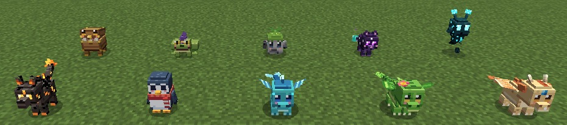
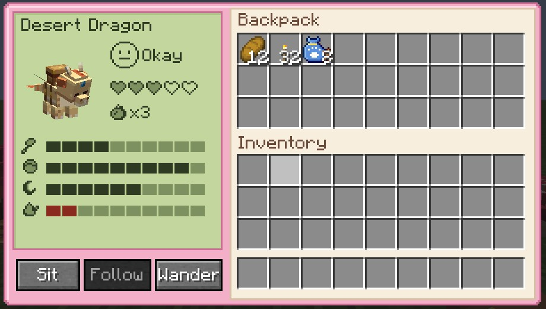
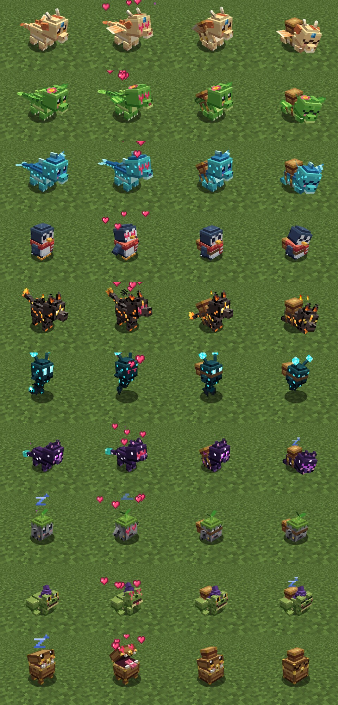
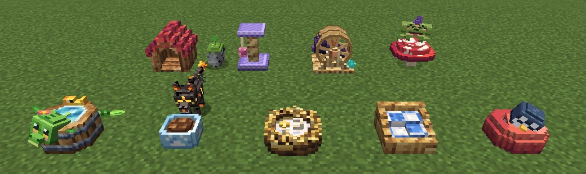
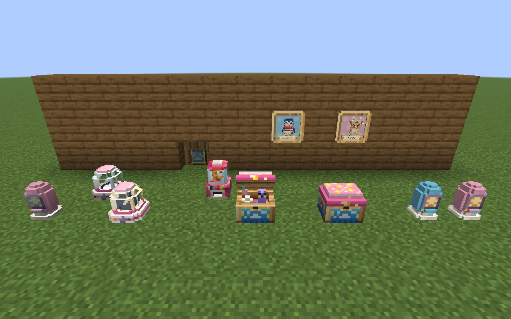
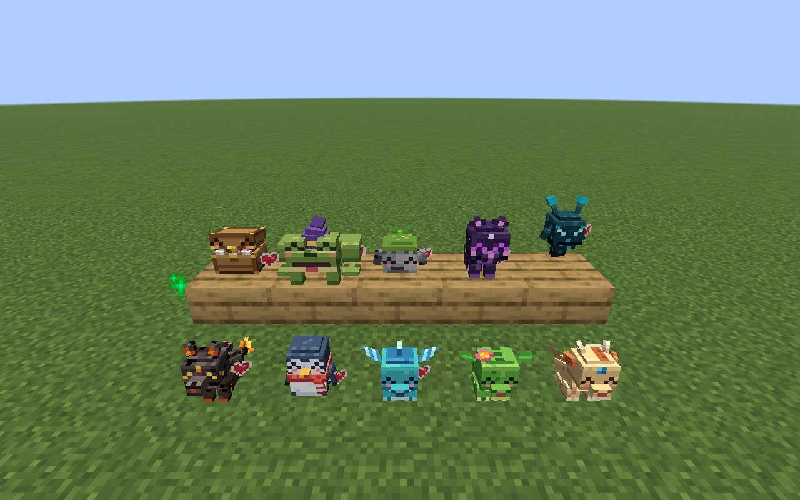

# Tamagotchi

A Fabric mod for **Minecraft 26.3**: ten rare pets hide in the world's structures. Find one, tame it with a
**Tamagotchi Heart**, and look after it – feed it, play with it, keep it clean and let it sleep – and it becomes
your best friend: it follows you, carries a backpack, helps you fight, feeds you golden apples when you are hurt
and has a special talent.

## The pets

| Pet | Lives in (chance per structure) | Talent | Favourite treat |
|---|---|---|---|
| Desert Dragon | Desert pyramid (40 %) | **Ember Roast** – hand it raw food or ore, it roasts / smelts it | Dragon Fruit |
| Jungle Dragon | Jungle temple (40 %) | **Green Thumb** – crops and saplings around it grow | Dragon Fruit |
| Tide Dragon | Ocean monument (50 %) | **Tide Blessing** – Water Breathing + Dolphin's Grace while you swim near it | Fish Crackers |
| Frost Penguin | Igloo (45 %) | **Frost Steps** – water freezes under your feet while it follows you | Fish Crackers |
| Ember Pup | Nether fortress (30 %) | **Warm Heart** – Fire Resistance when you catch fire; swims in lava | Ember Jerky |
| Sculk Wisp | Ancient city (50 %) | **Echo Sense** – sonar ping makes hostile mobs glow through walls | Glow Gummy |
| Void Kitten | End city (30 %) | **Item Magnet** – pulls dropped items into its backpack or to you | Fish Crackers |
| Pebble Golem | Trail ruins (35 %), mineshafts (8 %) | **Ore Sniffer** – sniffs out the best ore nearby and shows the way | Rock Candy |
| Hex Toad | Swamp hut (45 %) | **Brew Buddy** – brews you a random helpful potion effect | Glow Gummy |
| Mimic | Trial chambers (30 %), woodland mansion (60 %) | **Treasure Belly** – 27-slot belly (54 with a backpack), coughs up treasure | Golden Biscuit |

Wild pets stay around their structure and never despawn. The cute ones run away when hit; the
Ember Pup, Sculk Wisp and Mimic bite back. Hold a Tamagotchi Heart and they come closer.

## Controls

| On your pet | |
|---|---|
| Right-click, empty hand | Pet it ♥ |
| Sneak + right-click, empty hand | Pet screen: needs, mood, bond, talent, **backpack**, Sit / Follow / Wander |
| Sneak + right-click **with a chest** | Backpack on (27 slots) |
| Sneak + right-click **with shears** | Backpack off – **everything inside spills out** |
| Right-click with the **Tama Pager** | Sit / Stay ↔ Follow |
| Right-click with food / treat | Feed it |
| Right-click with a **golden apple** | Into its backpack – it brings you one when your health is low |
| Right-click with the Pet Brush | Groom it |
| Lead / Name Tag | Work like on any pet |

Use the Tama Pager in the air to open the screen of your nearest pet (within 64 blocks); it **beeps** when a pet is
hungry, bored, sleepy, dirty or hurt. You get a free pager the first time you tame a pet. The craftable **Tamacon**
(book + pink dye + redstone) is the in-game guide to everything.

## Taking care of it

Four needs – **Hunger, Fun, Energy, Hygiene** – make up the **Mood**, shown on the pager screen and as little
bubbles over the pet's head. Happy pets use their talent; sad pets don't; miserable pets refuse to fight.
**Bond** (the hearts on the screen) grows with every bit of care and makes talents recharge faster.

* **Hunger** – Pet Kibble, its favourite treat, its usual food, or a Food Bowl it eats from by itself
* **Fun** – petting, Laser Pointer, Squeaky Ball (fetch!), Feather Wand, Bouncy Mushroom, Running Wheel, Scratching Post,
  Toy Box, plushies, other pets
* **Energy** – sleeping in a Pet Bed / Basket / Dragon Nest at night or when tired (faster next to a plush of its own kind)
* **Hygiene** – Pet Brush or a filled Pet Bath

The three dragons fly when that is faster (or just for fun). In a fight a pet helps like a wolf. Below a third of its health it stops, runs to you and eats food from its
backpack to heal. Tamed pets never die: they **faint into a Tama Egg** that keeps everything – use the egg to wake them up.

Pets also react to the world: they dance to jukeboxes, warm up at campfires, sniff flowers, beg for cake and for
your food, hide from thunderstorms, shake off water, cheer when you level up, play with each other, sleep next
to your bed, and the penguin belly-slides on snow and ice.

## Furniture

Pet Bed, Pet Basket, Dragon Nest (sleep) · Food Bowl (fill with food) · Pet Bath (fill with a water bucket) ·
Bouncy Mushroom (everyone bounces) · Running Wheel (gives a redstone signal while a pet runs in it) ·
Scratching Post · Pet House (shelter from rain). All craftable; see the recipe book.

Gadgets and decoration (1.1):

* **Plushies** of all ten pets – squeeze them; lonely pets cuddle them; sleeping next to its own plush rests faster
* **Pet Portrait** – click it and it paints your nearest pet with its name (again for the next pet); dye the backdrop
* **Treat Dispenser** – fill it with treats and give it a redstone pulse: it shoots one to the hungriest pet, which catches it
* **Pet Incubator** – a Tama Egg hatches in 30 s, fully healed and rested
* **Toy Box** – bored pets open it and play with the toys inside
* **Pet Flap** – pets walk through, everyone else is blocked (other mobs path around it)
* **Egg Lamp** – a glowing night light; the Pet Bed, Pet Basket, Egg Lamp and portrait backdrop take any dye

## Compatibility

JEI and REI show every recipe plus info pages on where to find each pet (optional plugins in `compat/`).

## Releasing

Releases are automatic: pushing a tag `v<mod_version>` makes `.github/workflows/release.yml` build the mod and upload
it to **CurseForge**, **Modrinth** and a **GitHub release**, with that version's section of `CHANGELOG.md` as the
changelog (mod-publish-plugin, `publishMods`). Every other push runs the same upload as a dry run in
`.github/workflows/build.yml`.

One-time setup:

1. Create the project on CurseForge and on Modrinth (description and images: `docs/curseforge/`).
2. Put their ids into `gradle.properties`: `curseforge_id` (the number under "Project ID" on the CurseForge project
   page) and `modrinth_id` (the id from the Modrinth project page, "Copy ID").
3. Create the tokens and add them as repository secrets (GitHub: Settings → Secrets and variables → Actions):
   - `CURSEFORGE_TOKEN` from https://legacy.curseforge.com/account/api-tokens
   - `MODRINTH_TOKEN` from https://modrinth.com/settings/pats with the scopes *Create versions*, *Read versions* and
     *Write versions*

Each release: raise `mod_version` in `gradle.properties`, add a `## <version>` section to `CHANGELOG.md`, push, then
`git tag v<version> && git push origin v<version>`. A tag that does not match `mod_version` is refused.

## Building

Java 25, `./gradlew build`. Art and sound sources live in `tools/` (`tools/petart`, `tools/sprites`,
`tools/sfx`, `tools/gui`, `tools/data`) and regenerate every texture, model and sound. The client game test
`./gradlew runClientGameTest` renders a review gallery into `build/run/clientGameTest/screenshots` and logs
functional checks as `[TamaTest] PASS/FAIL`. Headless: start `Xvfb :98`, then run it with
`DISPLAY=:98 SDL_VIDEO_FORCE_EGL=1` (needs the Mesa EGL libraries).
